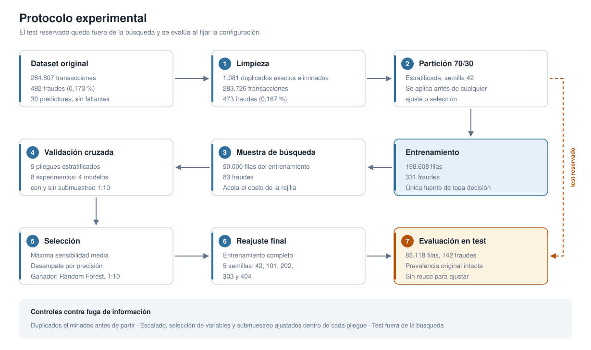
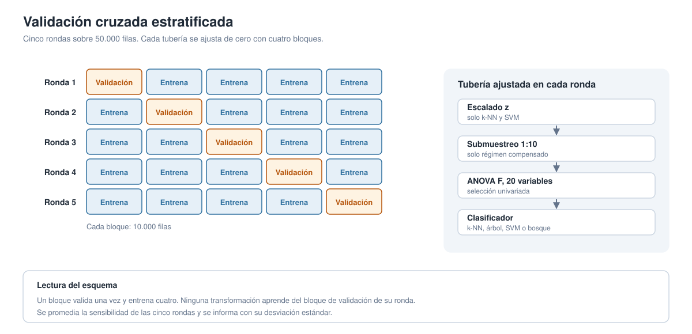
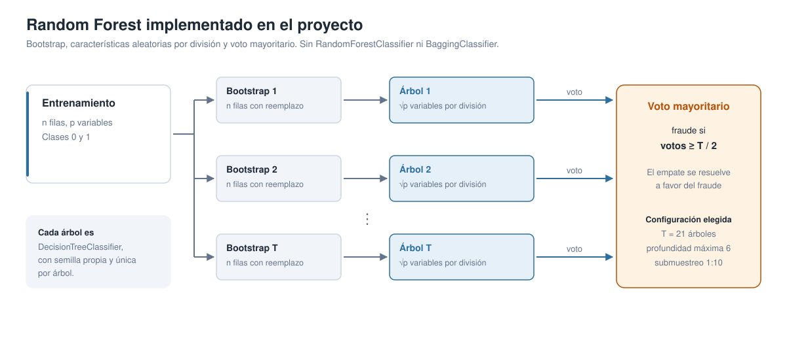
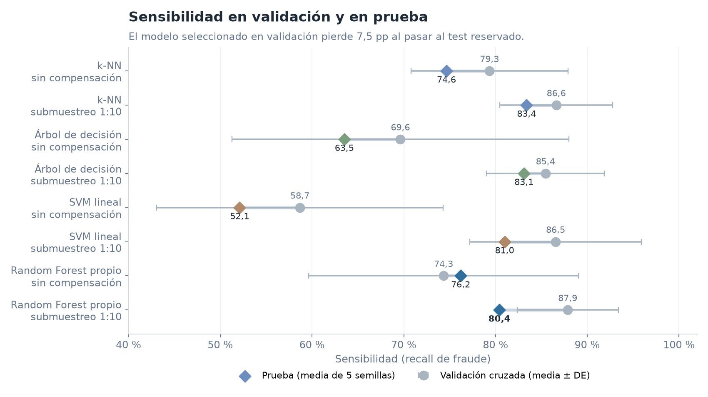
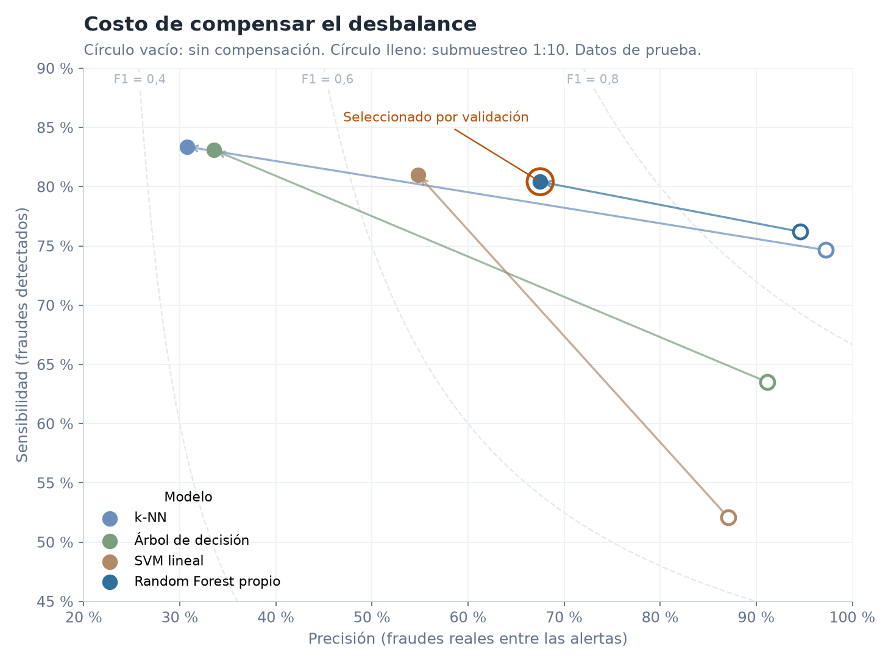
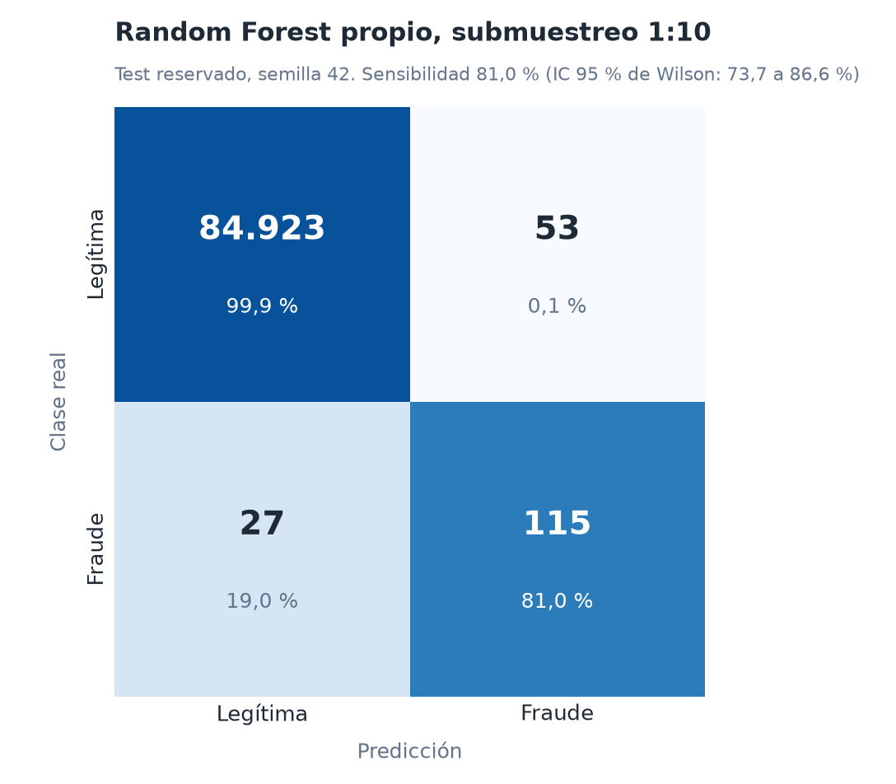

# Fraudetection

**Detección de fraude en tarjetas de crédito con clasificadores supervisados bajo desbalance extremo.**

[](https://github.com/FernandoValdes01/Fraudetection/actions/workflows/ci.yml)


Proyecto de INFO1185 Inteligencia Artificial. Autores: Fernando Alonso Valdés Gómez y Juan Francisco Muñoz Veloso.

## Resumen

El fraude con tarjetas es un problema de clasificación binaria con una clase minoritaria extrema: en el conjunto [Credit Card Fraud Detection](https://www.kaggle.com/datasets/mlg-ulb/creditcardfraud) solo el 0,167 % de las transacciones es fraudulenta. Un clasificador que declare todo legítimo alcanza 99,8 % de exactitud y no detecta nada, por lo que la exactitud no sirve como criterio.

Este trabajo compara cuatro familias de modelos (k-NN, árbol de decisión, SVM lineal y un Random Forest implementado desde sus componentes) con y sin submuestreo aleatorio de la clase mayoritaria. Los ocho experimentos se evalúan con validación cruzada estratificada y un conjunto de prueba reservado. El criterio de selección es la **sensibilidad** al fraude, porque un falso negativo es una transacción fraudulenta que pasa sin alerta. La precisión actúa como desempate y como contrapeso al analizar el costo en falsas alarmas.

| Resultado principal | Valor |
| --- | ---: |
| Modelo seleccionado por validación | Random Forest propio, 21 árboles, profundidad 6, submuestreo 1:10 |
| Sensibilidad en validación cruzada | 87,9 % ± 5,5 pp |
| Sensibilidad en prueba reservada | 80,4 % (media de cinco semillas) |
| Precisión en prueba | 67,5 % |
| Falsos negativos en prueba | 27,8 de 142 fraudes (media de cinco semillas) |
| Falsas alarmas en prueba | 55,6 de 84.976 transacciones legítimas |

## Contribuciones

1. **Un protocolo sin fuga de información.** Los duplicados se eliminan antes de partir, y el escalado, la selección de variables y el submuestreo se ajustan dentro de cada pliegue. El test no interviene en ninguna decisión.
2. **Un Random Forest propio** ([`forest.py`](src/fraudetection/forest.py), 90 líneas) con bootstrap, características aleatorias por división y voto mayoritario. No usa `RandomForestClassifier` ni `BaggingClassifier`, y tiene pruebas unitarias.
3. **Una comparación factorial de ocho experimentos** (4 modelos × 2 regímenes) con las mismas particiones, medida en validación y en prueba, que cuantifica el intercambio entre sensibilidad y precisión.
4. **Artefactos auditables.** Las tablas, los metadatos con el hash SHA-256 del dataset y las semillas se versionan en [`resultados/`](resultados/). Las figuras de este documento se regeneran desde esos archivos sin el dataset.

## Datos

| Etapa | Transacciones | Fraudes |
| --- | ---: | ---: |
| Dataset original | 284.807 | 492 (0,173 %) |
| Tras eliminar 1.081 duplicados exactos | 283.726 | 473 (0,167 %) |
| Entrenamiento (70 %) | 198.608 | 331 |
| Prueba reservada (30 %) | 85.118 | 142 |
| Muestra de búsqueda (subconjunto del entrenamiento) | 50.000 | 83 |

Cada transacción tiene 30 predictores: `Time`, `Amount` y `V1` a `V28`, componentes principales anonimizadas por el proveedor. No hay valores faltantes. La partición es estratificada con semilla 42 y la prevalencia se conserva en validación y prueba.

## Protocolo experimental



La partición produce solo dos conjuntos, entrenamiento y prueba. No existe un tercer conjunto fijo de validación. La validación ocurre dentro del entrenamiento, sobre una muestra estratificada de 50.000 filas que acota el costo de la búsqueda de hiperparámetros.



En cada ronda se ajusta una tubería nueva con 40.000 filas y se evalúa con las 10.000 restantes. El orden de la tubería es escalado z (solo k-NN y SVM), submuestreo 1:10 (solo régimen compensado), selección ANOVA F de 20 variables y clasificador. Elegida la configuración, cada modelo se reajusta con el entrenamiento completo, y con submuestreo 1:10 recibe 331 fraudes y 3.310 legítimas (3.641 filas). Los cinco reajustes finales usan las semillas 42, 101, 202, 303 y 404 y se evalúan sobre el mismo test.

### Modelos y espacio de búsqueda

| Modelo | Hiperparámetros evaluados | Mejor sin compensación | Mejor con submuestreo |
| --- | --- | --- | --- |
| k-NN (pesos por distancia) | `k` ∈ {3, 5, 7} | `k` = 3 | `k` = 3 |
| Árbol de decisión | profundidad ∈ {5, 10, ilimitada}, hoja mínima ∈ {1, 5} | profundidad 5, hoja 5 | profundidad 5, hoja 5 |
| SVM lineal | `C` ∈ {0,1; 1; 10} | `C` = 10 | `C` = 10 |
| Random Forest propio | árboles ∈ {11, 21}, profundidad ∈ {6, 12} | 21 árboles, profundidad 12 | 21 árboles, profundidad 6 |

### Random Forest propio



Cada árbol es un `DecisionTreeClassifier` con semilla única, entrenado sobre una muestra bootstrap y con `max_features = √p` por división. La clase se decide por voto mayoritario y el empate se resuelve a favor del fraude, coherente con la prioridad de minimizar falsos negativos.

## Resultados



| Modelo | Submuestreo | Sensibilidad validación (± DE) | Sensibilidad prueba | Precisión prueba | F1 prueba | Falsos negativos | Falsas alarmas |
| --- | --- | ---: | ---: | ---: | ---: | ---: | ---: |
| k-NN | no | 79,3 ± 8,6 | 74,6 | 97,2 | 84,5 | 36,0 | 3,0 |
| k-NN | 1:10 | 86,6 ± 6,1 | 83,4 | 30,7 | 44,8 | 23,6 | 271,4 |
| Árbol de decisión | no | 69,6 ± 18,4 | 63,5 | 91,1 | 74,9 | 51,8 | 8,8 |
| Árbol de decisión | 1:10 | 85,4 ± 6,4 | 83,1 | 33,6 | 47,0 | 24,0 | 261,6 |
| SVM lineal | no | 58,7 ± 15,6 | 52,1 | 87,1 | 65,2 | 68,0 | 11,0 |
| SVM lineal | 1:10 | 86,5 ± 9,3 | 81,0 | 54,8 | 65,2 | 27,0 | 98,0 |
| Random Forest propio | no | 74,3 ± 14,7 | 76,2 | 94,6 | 84,4 | 33,8 | 6,2 |
| **Random Forest propio** | **1:10** | **87,9 ± 5,5** | **80,4** | **67,5** | **73,3** | **27,8** | **55,6** |

Valores en porcentaje, salvo los conteos de errores. Los conteos son la media de cinco reajustes sobre el mismo test de 85.118 filas. Fila en negrita: modelo seleccionado por validación. Datos completos en [`cv_resumen.csv`](resultados/cv_resumen.csv), [`test_resumen.csv`](resultados/test_resumen.csv) y [`test_repeticiones.csv`](resultados/test_repeticiones.csv).



### Discusión

- **El submuestreo 1:10 sube la sensibilidad en los cuatro modelos.** En validación gana entre 7,3 pp (k-NN) y 27,9 pp (SVM). En prueba el efecto se confirma, entre 4,2 pp (Random Forest) y 28,9 pp (SVM).
- **El costo es precisión.** Con submuestreo, k-NN pasa de 97,2 % a 30,7 % de precisión: de 3 a 271 falsas alarmas sobre los mismos 85.118 casos. El Random Forest limita esa caída a 67,5 %.
- **La selección por sensibilidad es estrecha.** Entre los cuatro modelos compensados, las sensibilidades de validación (85,4 a 87,9 %) quedan dentro de una desviación estándar entre sí. La ventaja del bosque se sostiene en la precisión: en prueba logra el mayor F1 de los modelos compensados (73,3 % frente a 65,2 % del SVM y 45 a 47 % de k-NN y árbol) con 27,8 fraudes perdidos frente a 27,0 del SVM.
- **Hay una brecha entre validación y prueba.** El modelo elegido pasa de 87,9 % a 80,4 % de sensibilidad. La muestra de búsqueda contiene solo 83 fraudes y el test 142, así que un fraude equivale a 0,7 pp. Elegir el mejor de ocho configuraciones sobre una muestra pequeña tiende a sobrestimar su desempeño. Con la semilla 42, que detecta 115 de 142 fraudes (81,0 %), el intervalo de Wilson al 95 % es 73,7 a 86,6 %. La estimación de validación queda apenas sobre ese rango, por lo que conviene leer 80,4 % como la cifra de referencia.
- **El Random Forest sin compensación es una alternativa válida** si el costo de una falsa alarma pesa más que el de un fraude omitido: detecta 76,2 % con 6 falsas alarmas y 94,6 % de precisión.

<p align="center">
  
</p>

Las desviaciones estándar de la tabla en prueba describen la variación del reajuste entre semillas sobre un mismo test, no la incertidumbre de muestreo. Para esa incertidumbre sirve el intervalo de Wilson.

## Limitaciones

1. **Una sola partición.** El test es único y contiene 142 fraudes. Repetir la partición con otras semillas daría una estimación de varianza más fiel.
2. **Búsqueda sobre 50.000 filas.** Acota el costo, pero deja 83 fraudes para elegir hiperparámetros y reduce la estabilidad de la selección.
3. **Partición aleatoria, no temporal.** `Time` mide segundos desde la primera transacción, y una partición cronológica reflejaría mejor el uso real. No se evaluó.
4. **Umbral fijo.** Los modelos usan su regla de decisión por defecto. No se optimizó un umbral ni se incorporó un costo diferenciado por tipo de error.
5. **Rejillas pequeñas y SVM lineal.** El espacio de búsqueda es deliberadamente reducido y no incluye kernels no lineales.
6. **Duplicados.** El CSV no trae identificador de transacción, así que no se puede comprobar si dos filas idénticas son operaciones distintas.
7. **Variables anonimizadas.** `V1` a `V28` impiden interpretar qué patrones detecta el modelo.

## Reproducibilidad

Requiere Python 3.12 y [uv](https://docs.astral.sh/uv/getting-started/installation/). `uv.lock` fija las versiones: NumPy 2, pandas 3, scikit-learn 1, imbalanced-learn 0.14 y Matplotlib 3.

```bash
uv sync --locked
uv run --locked fraudetection download     # o copiar creditcard.csv en data/raw/
uv run --locked fraudetection-inspect      # exploración del dataset
uv run --locked fraudetection-run          # búsqueda, selección y evaluación
uv run --locked fraudetection-report       # gráficos y presentación de respaldo
```

El hash SHA-256 del CSV usado queda en [`resultados/metadata.json`](resultados/metadata.json). No hace falta el dataset para consultar los resultados ni para regenerar las figuras de este documento:

```bash
uv run --locked python scripts/build_figures.py
```

Verificación de calidad:

```bash
uv run --locked pytest -q                  # 43 pruebas
uv run --locked ruff check .
uv run --locked ruff format --check .
```

## Estructura del repositorio

| Ruta | Contenido |
| --- | --- |
| `src/fraudetection/` | Protocolo principal, Random Forest propio y comandos. |
| `src/fraudetection/reproduction/` | Protocolo auxiliar independiente de 100.000 filas y tres semillas. |
| `tests/` | Pruebas de datos, modelos, resultados y empaquetado. |
| `resultados/` | Tablas, metadatos y gráficos del protocolo principal. |
| `documentacion/figuras/` | Diagramas y gráficos de este README. |
| `documentacion/` | Pauta, exploración, integración de protocolos y material de estudio. |
| `scripts/` | Generación de figuras y empaquetado de la entrega. |

El protocolo auxiliar tiene muestras, modelos y ganadores distintos; sus resultados no se mezclan con los de arriba. Ver [integración](documentacion/contexto/integracion.md) y [reproducción](documentacion/contexto/reproduccion.md).

## Presentación y documentación

- [Presentación final en PDF](documentacion/presentacion/canva/Detección%20de%20fraude_FINAL.pdf), 22 páginas, y su [edición en Canva](https://canva.link/g838er8qsmu3bic).
- [Índice de documentación](documentacion/README.md): exploración del dataset, pauta y guiones de defensa.
- [Enunciado original](IA_2026_P2.pdf).

## Cómo citar

Los metadatos están en [`CITATION.cff`](CITATION.cff), que GitHub muestra en el botón *Cite this repository*.

## Referencias

1. Dal Pozzolo, A., Caelen, O., Johnson, R. A. y Bontempi, G. (2015). Calibrating probability with undersampling for unbalanced classification. *IEEE Symposium Series on Computational Intelligence*.
2. Breiman, L. (2001). Random forests. *Machine Learning*, 45(1), 5-32.
3. Pedregosa, F. et al. (2011). Scikit-learn: machine learning in Python. *Journal of Machine Learning Research*, 12, 2825-2830.
4. Lemaître, G., Nogueira, F. y Aridas, C. K. (2017). Imbalanced-learn: a Python toolbox to tackle the curse of imbalanced datasets in machine learning. *Journal of Machine Learning Research*, 18(17), 1-5.
